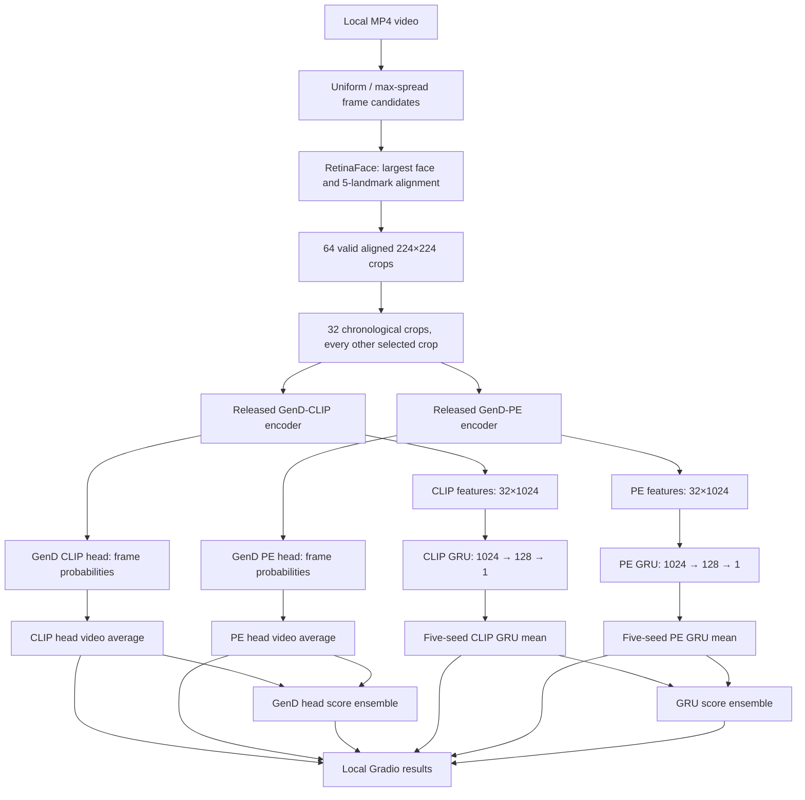
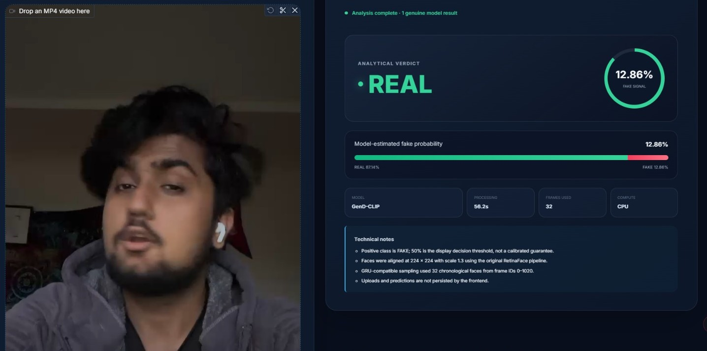
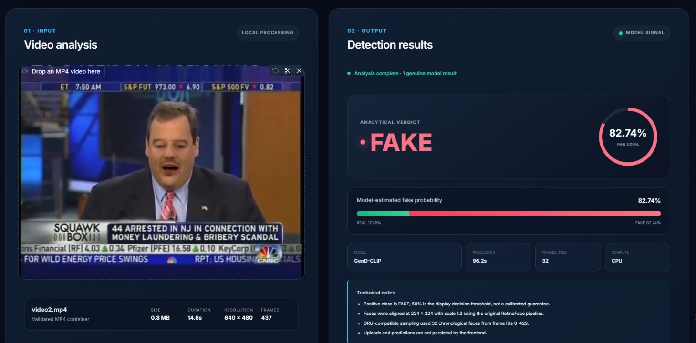
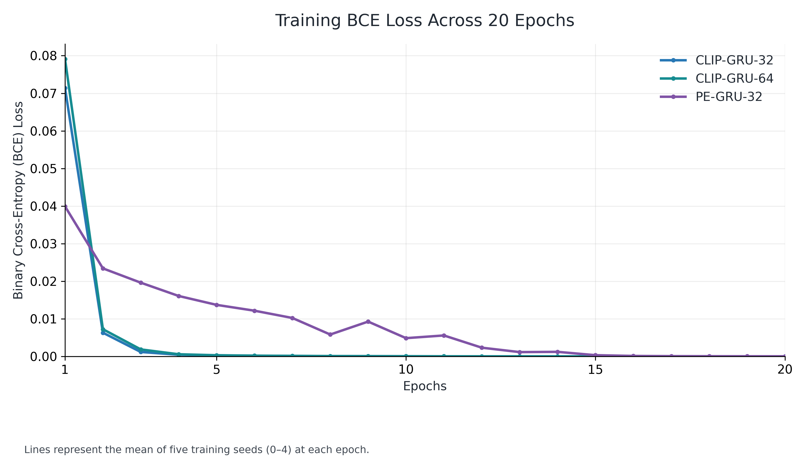
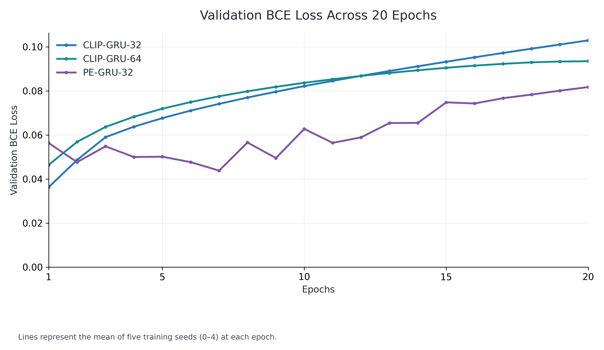
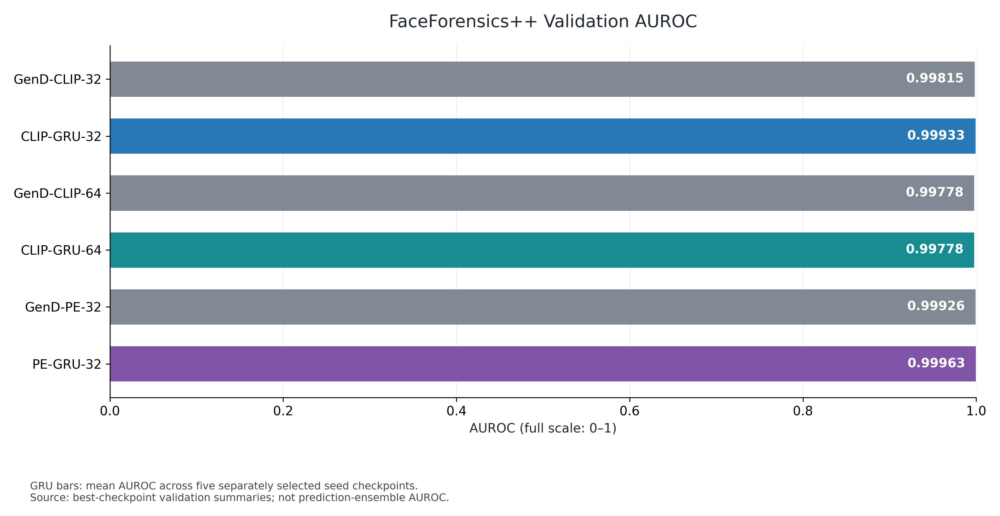
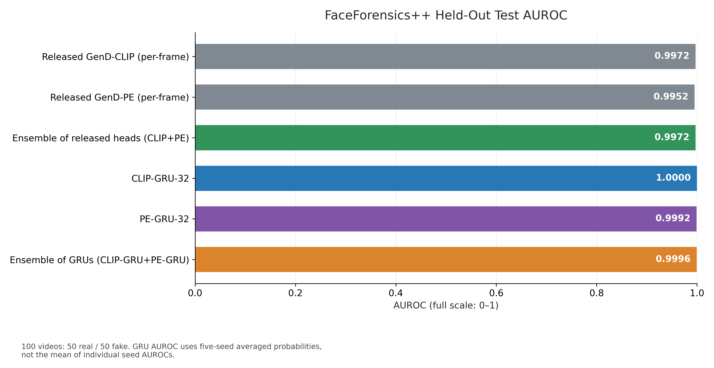
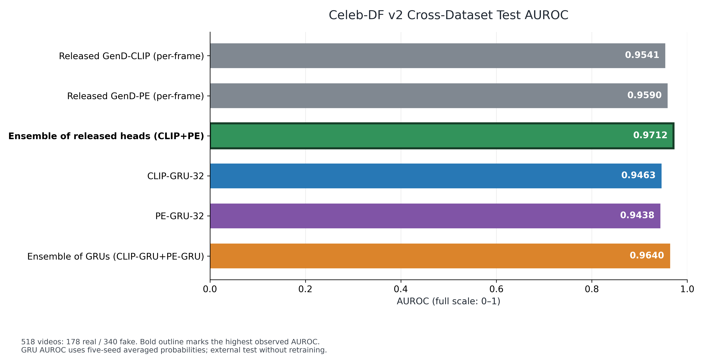

# GenD + Temporal GRU — Deepfake Video Detection

**An undergraduate capstone extension of [GenD](https://github.com/yermandy/GenD), studying whether temporal modeling and complementary visual encoders improve deepfake detection across datasets.**

   

> **Not the official GenD repository.** This is a university capstone project built on the original GenD implementation by Yermakov *et al.* Our contributions are the CLIP/PE temporal GRUs, controlled experiments, score-level ensembles, cross-dataset comparisons, and a local video-analysis frontend. The original GenD code and paper remain credited below.

**Jump to:** [Contributions](#what-we-built) · [Architecture](#system-architecture) · [Frontend](#local-frontend-demo) · [Experiment design](#datasets-and-experiment-protocol) · [Training](#training-behavior) · [Results](#results) · [Run locally](#run-the-frontend-locally) · [Citations](#original-research-and-attribution)

## Dataset Access and Reproducibility

The GRUs were trained using **1,020 FaceForensics++ c23 videos**, with the saved 255-group split (204 training / 26 validation / 25 test). Raw training videos and extracted dataset face samples are excluded from the proposed Git tree. Access is subject to the original provider's terms: obtain your own authorization through the [official FaceForensics++ process](https://github.com/ondyari/FaceForensics) and place training data at the [documented local paths](data/README.md).

Historical experiments, source code, manifests, approved result tables, graphs and screenshots are retained; benchmark results are unchanged. DVC manages locally available raw data using `data/faceforensic.dvc` and an ignored local cache. No DVC remote is configured, and a receipt does not grant access to private data. See [local DVC instructions](docs/LOCAL_DVC_SETUP.md).

The local frontend does not require FF++ training videos for inference on an uploaded video. Original GenD models can load from their official pretrained sources; CLIP-GRU and PE-GRU require the separately obtained trained checkpoints at their existing expected paths. The ten five-seed GRU-32 checkpoint files are absent from this checkout; the legacy pilot checkpoint is not a substitute.

Previously committed dataset files **remain in Git history**. A [separate coordinated history cleanup](docs/GIT_HISTORY_CLEANUP_PLAN.md) requires owner approval. Collaborators must back up local research data before pulling or checking out a future cleanup commit because Git can remove previously tracked working files.

## Project at a glance

We use two released GenD vision backbones—**CLIP ViT-L/14** and **Perception Encoder (PE)**—to encode aligned video frames into 1,024-dimensional embeddings. We then train independent **Gated Recurrent Unit (GRU)** models on ordered feature sequences to predict whether the *whole video* is manipulated. We compare the GRUs against the released GenD classification heads and against simple averages of model scores.

The main finding is nuanced: **GRUs perform extremely well on held-out FaceForensics++ videos, but the original CLIP+PE score ensemble generalizes best to Celeb-DF v2**. This is why we report both in-domain and external-dataset results rather than claiming the GRU is universally superior.

| Research snapshot | Value |
|---|---:|
| GRU training dataset | FaceForensics++ Deepfakes, c23; **1,020 videos** |
| Paired source groups | **255** (204 train / 26 validation / 25 test) |
| Training configurations | CLIP-GRU-32, CLIP-GRU-64, PE-GRU-32; **5 seeds each** |
| Best selected CLIP temporal configuration | **CLIP-GRU-32**, selected using mean validation AUROC |
| FF++ test-set videos | **100** (50 real / 50 fake) |
| Celeb-DF v2 external videos | **518** (178 real / 340 fake) |
| Best Celeb-DF v2 AUROC | **0.9712** — original GenD CLIP+PE ensemble |
| Demo deployment | **Localhost only**; not hosted as a public service |

## What we built

| Component | Our contribution | Code / results |
|---|---|---|
| CLIP temporal pipeline | 64-frame master extraction, paired source-group split, 32/64-frame GRU training and five-seed model selection | [`temporal/`](temporal/), [`LARGE_EXPERIMENT.md`](temporal/LARGE_EXPERIMENT.md) |
| PE temporal pipeline | PE feature extraction on the CLIP-selected frame IDs, independent PE-GRU-32 training across five seeds | [`build_pe_features.py`](temporal/build_pe_features.py), [`train_pe_gru.py`](temporal/train_pe_gru.py) |
| Baselines & ensembles | Released CLIP/PE GenD heads; score averaging of heads and of five-seed GRUs | [`compare_all.py`](temporal/compare_all.py) |
| Cross-dataset evaluation | Zero-shot evaluation on the Celeb-DF v2 official test subset | [`eval_celebdf_gru.py`](temporal/eval_celebdf_gru.py), [`final_comparison_celebdf.csv`](temporal/results_pe/final_comparison_celebdf.csv) |
| Local frontend | Gradio video upload, real inference, model availability checks, result cards and model comparison | [`frontend/`](frontend/), [`frontend/README.md`](frontend/README.md) |

### Supported detector configurations

| Detector | How a video score is produced | Trained or adapted by our group? |
|---|---|---|
| **GenD-CLIP** | Mean of frame-level GenD-CLIP FAKE probabilities | No — released GenD weights |
| **GenD-PE** | Mean of frame-level GenD-PE FAKE probabilities | No — released GenD weights |
| **GenD CLIP+PE ensemble** | Average of the two released-head video probabilities | No new training; our score-level comparison |
| **CLIP-GRU-32** | Five GRUs score CLIP frame-feature sequences; average seed probabilities | **Yes** |
| **PE-GRU-32** | Five GRUs score PE frame-feature sequences; average seed probabilities | **Yes** |
| **CLIP-GRU+PE-GRU ensemble** | Average of the two five-seed GRU probabilities | No additional training; our score-level ensemble |

CLIP-GRU-64 was also trained and evaluated as a **controlled frame-length experiment**. It is not one of the frontend's six selectable configurations.

## System architecture



For the temporal classifier, each video provides a tensor of shape **`[1, 32, 1024]`**: one video, 32 ordered frames, and 1,024 features per frame. A one-layer GRU with 128 hidden units produces its final hidden state; a linear layer maps it to one logit, and sigmoid converts it into a model-estimated fake probability. The original GenD baseline instead averages its frame-wise softmax probabilities. **Neither GRU replaces RetinaFace or GenD**: both depend on upstream face preprocessing and a GenD visual encoder.

## Local frontend demo

The capstone frontend is a separate implementation under [`frontend/`](frontend/), not the original upstream `app/run.py`. It uses **Gradio** and runs on **`127.0.0.1:7860` by default**, without a public Gradio share link. Users can upload an MP4 video, choose an available model or compare available models, and see a video-level verdict, probability, processing time, frame count, and device.

| Example: REAL-labeled analysis | Example: FAKE-labeled analysis |
|:--:|:--:|
|  |  |
| Screenshot: GenD-CLIP fake signal **12.86%** | Screenshot: GenD-CLIP fake signal **82.74%** |

*These screenshots show local single-video outputs, **not** benchmark metrics or verified ground-truth accuracy. A 50% threshold produces the displayed REAL/FAKE label; the percentage is not a calibrated guarantee.*

Frontend capabilities shown in code:

- MP4 validation (default maximum **500 MiB** and **300 seconds**), video preview, analysis progress, and descriptive failures.
- 64 aligned usable face frames collected before selecting 32 chronological crops for the trained GRU-compatible pipeline.
- Real inference using released GenD heads; GRU options activate only when all five compatible local checkpoints for the chosen backbone are present.
- Single-model scoring or **Compare available**, plus historical benchmark context displayed separately from the uploaded-video result.
- Automatic CUDA selection where available; CPU processing is supported but can be slow.
- Uploads and predictions are **not persisted by the frontend** by default; see [`frontend/repository.py`](frontend/repository.py).

### Run the frontend locally

**Prerequisites:** Python **3.12** recommended; a machine with enough RAM for the GenD backbones, internet access on first launch for uncached model downloads, and working video-decoding dependencies. Windows PowerShell commands below assume Git and Python are installed.

```powershell
# 1. Clone the project and enter its folder
git clone https://github.com/SanskarBajimaya/Capstone---GRU-and-GenD-Deepfake-Detector-.git
cd Capstone---GRU-and-GenD-Deepfake-Detector-

# 2. Use a dedicated frontend environment
py -3.12 -m venv .venv-frontend
.\.venv-frontend\Scripts\Activate.ps1
python -m pip install --upgrade pip

# 3. Install the frontend-compatible package set
python -m pip install -r frontend/requirements.txt

# 4. Start the local web app
python frontend/app.py
```

Open **http://127.0.0.1:7860** in the browser. The first model run can download published Hugging Face weights and the RetinaFace ONNX detector if those assets are missing. To stop the server, press `Ctrl+C` in the terminal.

> **Important dependency difference:** The original root research environment and the newer Gradio frontend specify different Transformers / Hugging Face Hub versions. Install **`frontend/requirements.txt` in its own virtual environment** for the app; do not simply install both requirement files into the same environment. Read [`frontend/README.md`](frontend/README.md) for compatibility details and troubleshooting.

If PowerShell does not allow the activation script, run the virtual environment's Python directly instead:

```powershell
.\.venv-frontend\Scripts\python.exe -m pip install -r frontend/requirements.txt
.\.venv-frontend\Scripts\python.exe frontend/app.py
```

Optional locally scoped limits (PowerShell):

```powershell
$env:GEN_D_MAX_UPLOAD_MB = "500"
$env:GEN_D_MAX_DURATION_SECONDS = "300"
$env:GEN_D_PORT = "7860"
python frontend/app.py
```

**Using the trained GRUs:** The repository includes historical performance reports but **does not ship the full GRU model weights**. Obtain the five completed CLIP-GRU-32 and/or PE-GRU-32 checkpoints privately from the researchers, then place them at these exact local paths:

```text
temporal/models/gru32_seed0_best.pt
temporal/models/gru32_seed1_best.pt
...
temporal/models/gru32_seed4_best.pt

temporal/models_pe/gru32_pe_seed0_best.pt
temporal/models_pe/gru32_pe_seed1_best.pt
...
temporal/models_pe/gru32_pe_seed4_best.pt
```

The app validates checkpoint metadata against the saved split and manifest. If checkpoints are absent, GRU options remain unavailable rather than returning invented predictions. **`temporal/models/best_gru.pt` is a separate 16-frame pilot checkpoint, not a substitute for the 32-frame experiments.** Never commit checkpoints or restricted videos to GitHub.

Run the frontend tests from the repository root:

```powershell
python -m unittest discover -s frontend/tests -v
```

For advanced troubleshooting, CUDA setup, model provisioning and detailed file responsibilities, see [`frontend/README.md`](frontend/README.md).

## Datasets and experiment protocol

| Dataset / subset | Purpose | Real | Fake | Total |
|---|---|---:|---:|---:|
| FaceForensics++ Deepfakes / c23 — train | GRU training on paired sources | 408 | 408 | **816** |
| FaceForensics++ Deepfakes / c23 — validation | Checkpoint and architecture selection | 52 | 52 | **104** |
| FaceForensics++ Deepfakes / c23 — test | Held-out, **in-domain** evaluation | 50 | 50 | **100** |
| **FF++ total** | 255 groups, four related videos per group | **510** | **510** | **1,020** |
| Celeb-DF v2 official test subset | **External, cross-dataset** evaluation | **178** | **340** | **518** |

**Data leakage precautions.** Each FF++ source group contains two original videos and their two reciprocal face-swap manipulations; all four remain within the same train, validation, or test partition. The split uses seed 2026 and group counts **204 / 26 / 25**. No Celeb-DF v2 videos were used to train or tune the GRUs.

**Frame preprocessing.** RetinaFace detects the largest usable face, aligns it using facial landmarks, expands the face region with scale **1.3**, and produces **224 × 224** face crops. The CLIP experiment stores up to 64 ordered-frame features per video and derives a consistent 32-frame subset by taking alternating indices. The PE experiment processes those corresponding frame IDs. For external Celeb-DF evaluation, 13 videos with fewer than 32 detected crops were padded by repeating the last crop; this is an evaluation limitation, not a training technique.

**Training settings:** frozen released GenD backbone; feature size 1,024; one-layer GRU with hidden size 128; linear 128→1 head; `BCEWithLogitsLoss`; Adam, learning rate **0.001**; batch size **4**; **20 epochs**; five random seeds (**0–4**). The selected checkpoint for each run maximized validation AUROC, with lower validation BCE breaking ties. The primary CLIP 32-vs-64 decision used mean validation AUROC, not the held-out test results.

Detailed protocol and original scripts: [`temporal/LARGE_EXPERIMENT.md`](temporal/LARGE_EXPERIMENT.md), [`build_manifest.py`](temporal/build_manifest.py), [`train_large_gru.py`](temporal/train_large_gru.py), and [`train_pe_gru.py`](temporal/train_pe_gru.py).

## Training behavior

The curves below are calculated from saved epoch logs for **CLIP-GRU-32**, **CLIP-GRU-64**, and **PE-GRU-32**, each with five independent seeds. The plots average the per-epoch measurements across the five seeds; **they are not cross-dataset test scores**.





| Temporal configuration | Epoch-20 mean training BCE ↓ | Epoch-20 mean validation BCE ↓ | Epoch-20 mean training accuracy |
|---|---:|---:|---:|
| CLIP-GRU-32 | **0.000016** | 0.102911 | 100.0% |
| CLIP-GRU-64 | **0.000018** | 0.093444 | 100.0% |
| PE-GRU-32 | **0.000063** | 0.081715 | 100.0% |

*Epoch-20 values are from training-history logs, **not necessarily the selected checkpoints**. Training accuracy nearing 100% while later validation BCE rises is a reason to retain validation-based checkpoint selection and to examine generalization. The original released GenD heads were not trained in this capstone, so there are no directly comparable in-project GenD training curves.*

## Results

**Metric key:** AUROC measures ranking quality across thresholds (**higher is better**); AP is average precision (**higher is better**); accuracy uses a 0.5 classification threshold; BCE and EER are error measures (**lower is better**). Means over independently trained seeds and AUROC calculated after averaging seed predictions are **different statistics** and are kept separate below.

### 1. FaceForensics++ validation — model selection



*The AUROC graph uses a zoomed vertical scale to show small differences between already high scores; use the numeric table for precise comparisons.*

| Configuration | Validation AUROC | Validation accuracy | Validation BCE |
|---|---:|---:|---:|
| Released GenD-CLIP, 32 frames | 0.998151 | 97.12% | 0.157012 |
| **CLIP-GRU-32** (5-seed mean) | **0.999334 ± 0.000992** | **98.85%** | 0.063913 |
| Released GenD-CLIP, 64 frames | 0.997781 | 98.08% | 0.155915 |
| CLIP-GRU-64 (5-seed mean) | 0.997781 ± 0.002108 | 99.04% | 0.054339 |
| Released GenD-PE, 32 frames | 0.999260 | 98.08% | 0.071063 |
| PE-GRU-32 (5-seed mean) | 0.999630 ± 0.000000 | 98.65% | 0.036325 |

**Selection:** CLIP-GRU-32 won the predefined frame-length comparison because its mean validation AUROC (0.999334) exceeded CLIP-GRU-64 (0.997781). This does **not** mean 32 frames outperform 64 on every metric or every subsequent test. Individual 32-frame seed 4 reached validation AUROC 1.0, validation accuracy 100%, and BCE 0.000585 at its selected epoch. The PE-GRU-32 study is a separate backbone comparison using the same train/validation split.

Sources: [`validation_summary.csv`](temporal/results/validation_summary.csv), [`gru32_pe_validation_summary.csv`](temporal/results_pe/gru32_pe_validation_summary.csv), [`experiment_results.csv`](temporal/results/experiment_results.csv).

### 2. FaceForensics++ held-out test — six detector comparison



*The horizontal AUROC axis spans 0–1; numeric labels show differences near the ceiling.*

| Model | AUROC ↑ | AP ↑ | EER ↓ |
|---|---:|---:|---:|
| GenD-CLIP | 0.9972 | 0.9975 | 1.0% |
| GenD-PE | 0.9952 | 0.9961 | 1.0% |
| GenD CLIP+PE ensemble | 0.9972 | 0.9975 | 1.0% |
| **CLIP-GRU-32** (seed-probability ensemble) | **1.0000** | **1.0000** | **0.0%** |
| PE-GRU-32 (seed-probability ensemble) | 0.9992 | 0.9992 | 3.0% |
| CLIP-GRU+PE-GRU ensemble | 0.9996 | 0.9996 | 2.0% |

These six rows evaluate the same **100 FF++ test videos**, with GRU seed **probabilities averaged per video before computing AUROC**. In contrast, the separate per-run report finds a mean test AUROC of **0.999680 ± 0.000335** and mean test accuracy **99.0%** for CLIP-GRU-32; CLIP-GRU-64 achieved **0.999840 ± 0.000219** AUROC and **99.4%** mean accuracy. CLIP-GRU-64 was not selected because model selection happened earlier on validation. PE-GRU-32 achieved **0.9992** mean per-seed test AUROC and **98.0%** mean accuracy.

The near-ceiling FF++ scores establish strong **in-domain** performance, not proof of generalization to unseen manipulation methods. Reported bootstrap uncertainty is also limited by the small and source-related test sample.

Sources: [`final_comparison_ffpp.csv`](temporal/results_pe/final_comparison_ffpp.csv), [`test_summary.csv`](temporal/results/test_summary.csv), [`gru32_pe_test_summary.csv`](temporal/results_pe/gru32_pe_test_summary.csv), [`test_report.md`](temporal/results/test_report.md).

### 3. Celeb-DF v2 external test — six detector comparison



*The horizontal AUROC axis spans 0–1; the strongest model is outlined and its label is bold.*

| Model | External AUROC ↑ | AP ↑ | EER ↓ | Recall @ 1% FPR ↑ |
|---|---:|---:|---:|---:|
| GenD-CLIP | 0.9541 | 0.9720 | 11.93% | 48.24% |
| GenD-PE | 0.9590 | 0.9748 | 10.63% | 27.35% |
| **GenD CLIP+PE ensemble** | **0.9712** | **0.9815** | **9.20%** | **56.18%** |
| CLIP-GRU-32 | 0.9463 | 0.9659 | 10.06% | 17.94% |
| PE-GRU-32 | 0.9438 | 0.9654 | 12.21% | 33.82% |
| CLIP-GRU+PE-GRU ensemble | 0.9640 | 0.9756 | 10.78% | 28.24% |

Celeb-DF v2 is an **external test set**: our FF++-trained GRUs were evaluated without retraining on this dataset. The head ensemble's **0.9712 AUROC** was the strongest external result. The GRU ensemble improved on either individual GRU (0.9640 vs 0.9463 / 0.9438) but remained below the original-head ensemble. **The result does not support a blanket claim that temporal modeling improves cross-dataset generalization.**

The saved paired-bootstrap comparison reports a head-ensemble advantage of roughly **+0.0172 AUROC versus CLIP** and **+0.0122 versus PE**. These intervals were estimated by resampling videos, so group and identity dependencies should be considered when interpreting significance. See [`final_comparison_gains.csv`](temporal/results_pe/final_comparison_gains.csv) for all reported deltas and intervals.

Sources: [`final_comparison_celebdf.csv`](temporal/results_pe/final_comparison_celebdf.csv), [`celebdf_gru_summary.csv`](temporal/results_pe/celebdf_gru_summary.csv), and [`FINAL_REPORT.md`](temporal/results_pe/FINAL_REPORT.md).

### Interpretation

1. **Temporal learning is effective in-domain.** Both GRU backbones distinguish FF++ real/fake videos very well on the saved held-out groups.
2. **Backbone diversity helps on the external benchmark.** Averaging CLIP and PE predictions achieves the strongest Celeb-DF result without training another classifier.
3. **Generalization is not automatic.** Learned temporal patterns from FF++ Deepfakes may transfer less reliably to Celeb-DF v2; this is a plausible explanation, not a causal mechanism demonstrated by an ablation.
4. **The demo is a research prototype.** A single 0.5-threshold fake probability is not a certified authenticity verdict; real-world false positives and domain shift matter.

## Repository structure

```text
.
├── README.md                       # This capstone overview
├── src/                            # Original GenD models and training code
├── detector.py                     # Original face preprocessing / RetinaFace helpers
├── app/run.py                      # Original upstream GenD Gradio application
├── temporal/                       # CAPSTONE TEMPORAL BACKEND
│   ├── model_a.py                 # One-layer GRU + linear video classifier
│   ├── video_loader.py            # Chronological aligned face extraction
│   ├── build_manifest.py          # Pair-safe FF++ manifest and split
│   ├── build_master_features.py   # CLIP 64-frame master features
│   ├── build_pe_features.py       # PE 32-frame feature extraction
│   ├── train_large_gru.py         # CLIP-GRU 32/64 training
│   ├── train_pe_gru.py            # PE-GRU 32 training
│   ├── eval_celebdf_gru.py        # External Celeb-DF temporal inference
│   ├── compare_all.py             # Six-model result comparison
│   ├── results/                  # CLIP experiment CSV, JSON, reports
│   └── results_pe/               # PE, ensemble, external reports
├── frontend/                       # CAPSTONE LOCAL DASHBOARD
│   ├── app.py                     # Gradio interface
│   ├── preprocessing.py           # Validates MP4 and reuses research sampler
│   ├── model_loader.py            # Loads released heads and checks GRU assets
│   ├── predictor.py               # Prediction orchestration and score ensembles
│   ├── style.css                  # Dashboard styling
│   ├── requirements.txt           # Separate frontend-compatible environment
│   └── tests/                     # Frontend unit tests
└── docs/readme-assets/             # Screenshot and chart files for THIS README
```

The original repository also contains research configuration and experiment files not expanded in this diagram. Data, local checkpoints and generated embeddings are not required for **GenD-head-only** demo use, but the corresponding assets are required to reproduce training or run the GRUs.

## Limitations and research integrity

- **Data licensing:** FaceForensics++ is provided under controlled research-access terms. **Do not redistribute raw FF++ videos.** At the time this README was prepared, the Git history of this repository contained **1,020 tracked FF++ MP4 files**. Adding a `.gitignore` or deleting them in one later commit **does not purge old commits**. Restrict access, remove data from the full history, and check dataset permission obligations before any public release.
- **External evaluation scope:** A single external benchmark (Celeb-DF v2) is not enough to establish universal detection robustness.
- **Related-video dependence:** The FF++ split protects source-group independence across train/validation/test, but some confidence intervals in the existing comparison resample individual videos, not groups.
- **Preprocessing differences:** PE frame IDs align with CLIP frame IDs, but crops may differ slightly because PE extraction re-runs alignment. The existing Celeb-DF evaluation pads 13 short sequences by repeating the final crop.
- **Upstream domain overlap:** The released GenD detectors were adapted using FaceForensics++; the FF++ experiment is an in-domain comparison, not evidence of full training-data independence for those pretrained weights.
- **Runtime assets:** Full five-seed GRU checkpoints are not in the Git repository. No public hosted service is provided. CUDA/codec/weight downloads depend on the local environment.
- **Evaluation metric caveat:** Model probabilities and thresholded REAL/FAKE decisions should not be interpreted as proof of authenticity or calibrated probabilities.

## Original research and attribution

This capstone builds on the **original GenD research and code**, which remain the work of their respective authors:

- **Paper:** Andrii Yermakov, Jan Cech, Jiri Matas, and Mario Fritz, *Deepfake Detection that Generalizes Across Benchmarks*, WACV 2026. [arXiv:2508.06248](https://arxiv.org/abs/2508.06248).
- **Original GenD source:** [github.com/yermandy/GenD](https://github.com/yermandy/GenD)
- **Released model checkpoints:** [GenD collection on Hugging Face](https://huggingface.co/collections/yermandy/gend)
- **FaceForensics++ dataset and access:** [github.com/ondyari/FaceForensics](https://github.com/ondyari/FaceForensics)
- **Celeb-DF dataset:** [official Celeb-DF project](https://github.com/yuezunli/celeb-deepfakeforensics)

```bibtex
@inproceedings{GenD,
  title     = {Deepfake detection that generalizes across benchmarks},
  author    = {Yermakov, Andrii and Cech, Jan and Matas, Jiri and Fritz, Mario},
  booktitle = {Proceedings of the IEEE/CVF Winter Conference on Applications of Computer Vision},
  pages     = {773--783},
  year      = {2026}
}
```

The capstone's GRU pipelines, evaluation and frontend are described in this repository; they should not be mistaken for components claimed by the GenD paper's authors. Review the repository's [`LICENSE`](LICENSE) and all upstream/dataset licenses before sharing or reusing materials.

---

**Project scope:** reproducible research comparison and a local educational demonstration—not a forensic certification tool or a public video-upload service.
